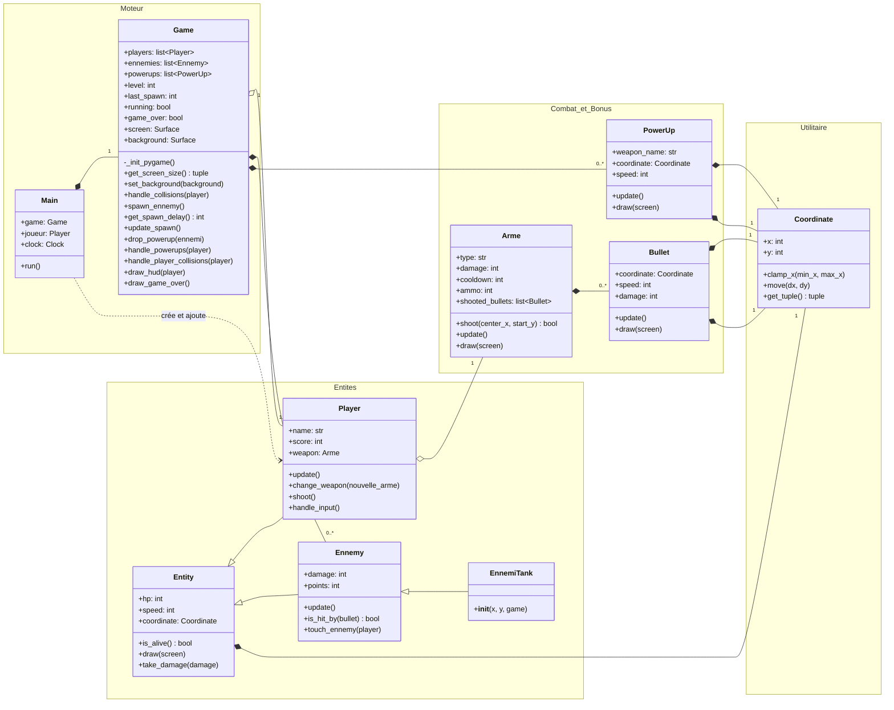

# Projet1-Yasin-Alaric

Un jeu d'arcade de type *Space Invader* développé en Python avec **Pygame**, issu de la refonte orientée objet d'un prototype procédural initial.

---

## Table des matières
- [Présentation du projet](#présentation-du-projet)
- [Fonctionnalités](#fonctionnalités)
- [Architecture & Diagramme de classes](#architecture--diagramme-de-classes)
- [Structure du dépôt](#structure-du-dépôt)
- [Installation et lancement](#installation-et-lancement)
- [Contrôles](#contrôles)
- [Auteurs](#auteurs)

---

## Présentation du projet

L'objectif de ce projet est de transformer un script procédural monolithique (`main.py` d'origine, reposant sur des variables globales et des tableaux parallèles) en une architecture **orientée objet modulaire, maintenable et extensible**, en appliquant les principes fondamentaux de la POO (encapsulation, héritage, polymorphisme, séparation des responsabilités).

---

## Fonctionnalités

- **Système d'entités hiérarchisé :** classe mère `Entity` factorisant les points de vie, la vitesse, les coordonnées (`Coordinate`), le rendu et la gestion des dégâts.
- **Types d'ennemis variés :**
  - `Ennemy` : ennemi standard se déplaçant horizontalement et descendant par paliers au contact des bords de l'écran.
  - `EnnemiTank` : sous-classe d'`Ennemy` plus lente mais dotée de 3 PV, infligeant davantage de dégâts et rapportant plus de points.
- **Difficulté progressive :** réduction dynamique du délai d'apparition des ennemis (`get_spawn_delay()`) au fur et à mesure que le score augmente.
- **Système d'armement évolutif :**
  - **Pistolet** : munitions illimitées, cadence standard (`400 ms`), 1 dégât.
  - **Mitraillette** : 40 munitions, cadence rapide (`150 ms`), 1 dégât.
  - **Canon** : 10 munitions, cadence lente (`800 ms`), 3 dégâts (capable de détruire un `EnnemiTank` en un tir).
  - Retour automatique au *Pistolet* lorsque les munitions d'une arme spéciale sont épuisées.
- **Power-ups dynamiques :** apparition probabiliste de bonus à la mort d'un ennemi permettant de changer d'arme en vol.
- **Interface HUD & Game Over :** affichage en temps réel du score, des points de vie restants, de l'arme équipée et de ses munitions.

---

## Architecture & Diagramme de classes

Le diagramme ci-dessous est rendu directement par GitHub via **Mermaid** :



---

## Structure du dépôt

```text
Projet1-Yasin-Alaric/
├── main.py          # Point d'entrée (classe Main) et boucle principale du jeu
├── game.py          # Moteur de jeu (classe Game), règles, collisions, spawns et HUD
├── entity.py        # Classe mère Entity (vie, position, affichage, dégâts)
├── player.py        # Classe Player (déplacements, score, gestion des entrées et de l'arme)
├── ennemy.py        # Classes Ennemy et EnnemiTank
├── arme.py          # Classe Arme, configuration ARMES et fabrique creer_arme()
├── bullet.py        # Classe Bullet (projectiles tirés par les armes)
├── powerup.py       # Classe PowerUp (bonus d'armes lâchés par les ennemis)
├── coordinate.py    # Classe Coordinate (gestion et bornage des positions 2D)
├── image/           # Sprites et arrière-plans (.png)
├── sounds/          # Effets sonores et musique (.wav)
├── requirements.txt # Dépendances Python du projet
└── README.md        # Documentation du projet
```
---

## Installation et lancement

### Prérequis
- **Python 3.10+**
- **Pygame** (ou `pygame-ce`)

### Étapes
1. Cloner le dépôt :
   ```bash
   git clone [https://github.com/YasinGitO/Projet1-Yasin-Alaric.git](https://github.com/YasinGitO/Projet1-Yasin-Alaric.git)
   cd Projet1-Yasin-Alaric
   ```
2. Installer les dépendances :
   ```bash
   pip install -r requirements.txt
   ```
3. Lancer le jeu :
   ```bash
   python main.py
   ```

---

## Contrôles

| Touche | Action |
| :--- | :--- |
| `Flèche Gauche` (`←`) | Déplacer le vaisseau vers la gauche |
| `Flèche Droite` (`→`) | Déplacer le vaisseau vers la droite |
| `Espace` | Tirer avec l'arme équipée |
| `Fermer la fenêtre` | Quitter le jeu |

---

## Auteurs

- **Yasin Ozlu**
- **Alaric Dehard**


